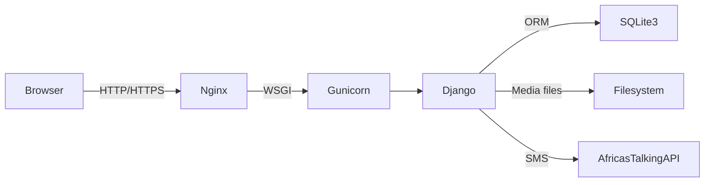
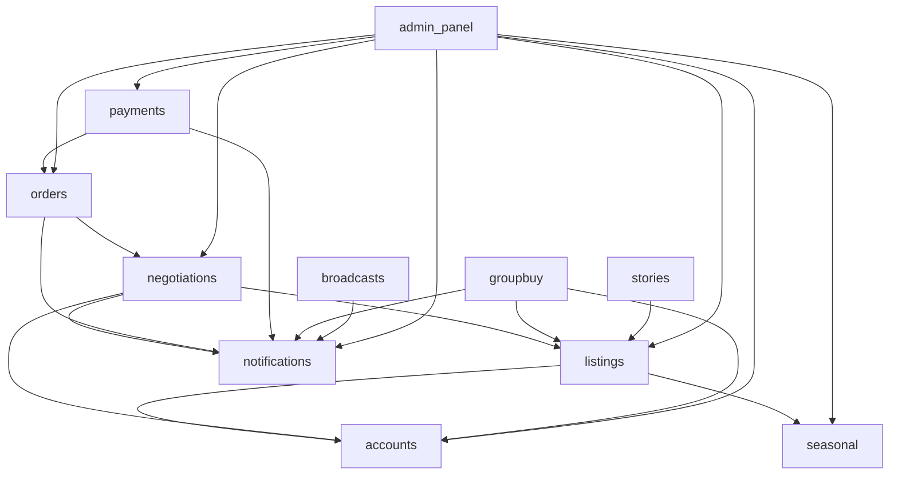
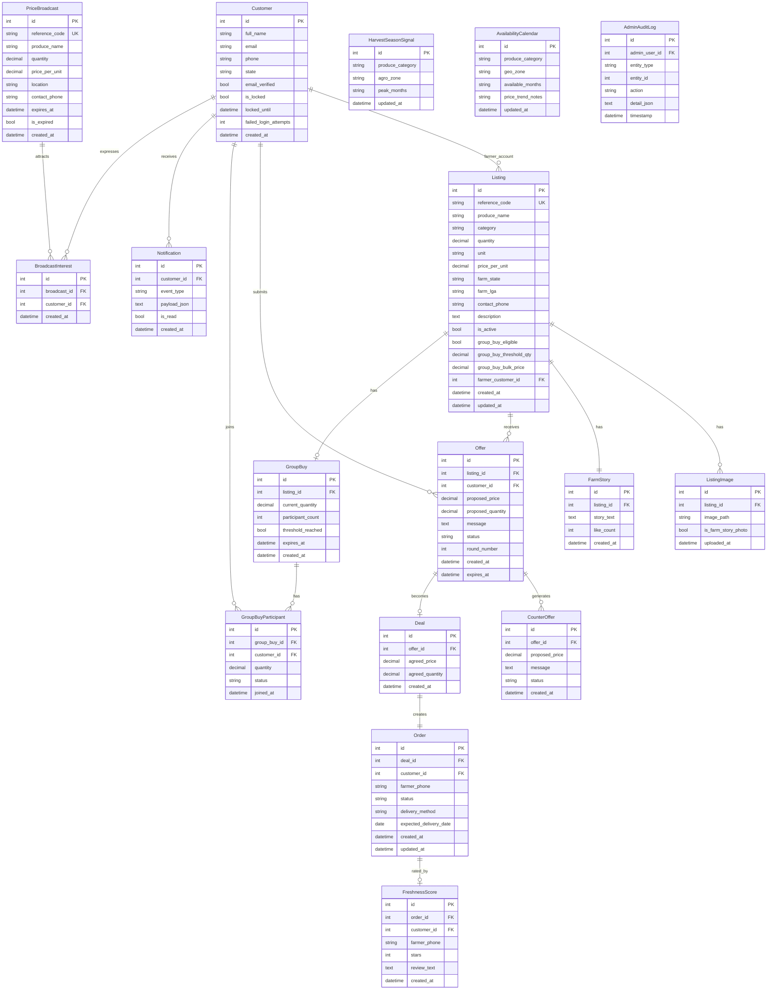
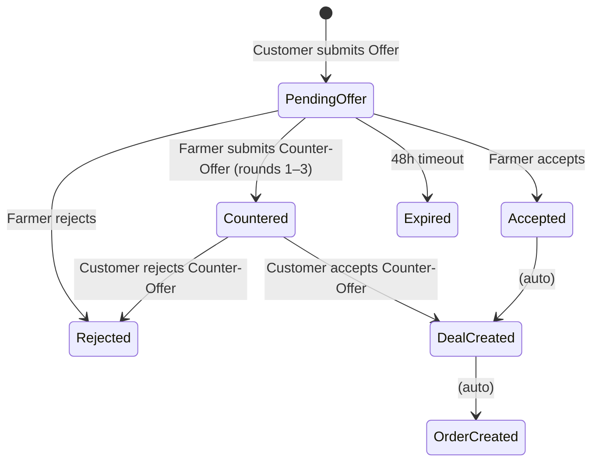
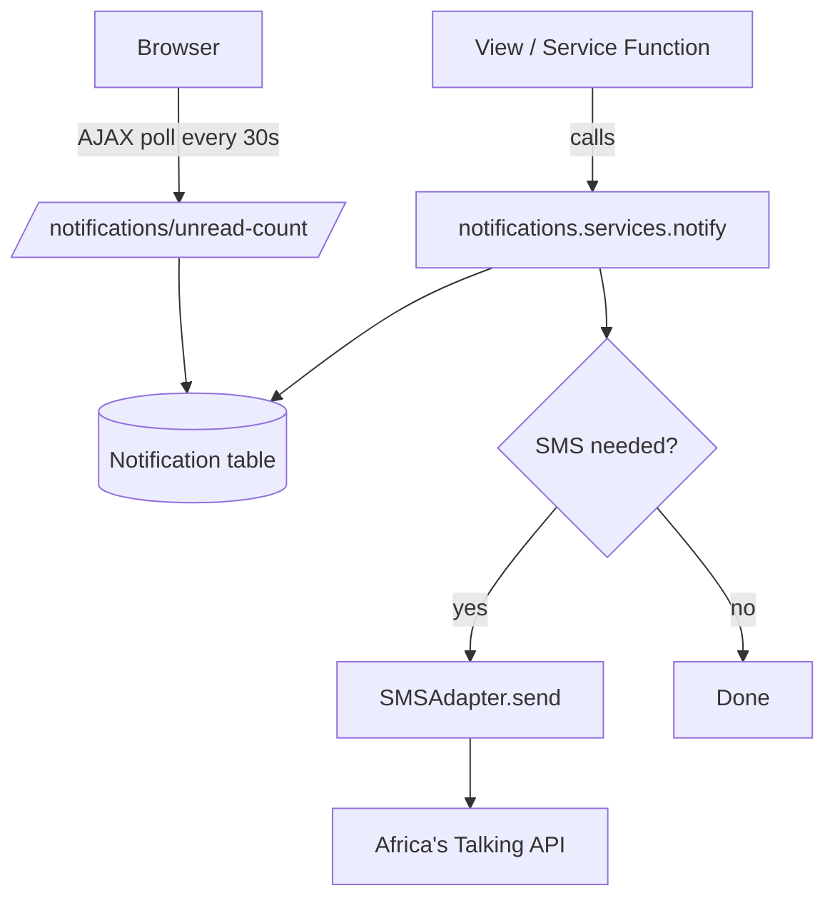

# Design Document: AgroConnect Agri-Marketplace Platform

## Overview

AgroConnect is a Django-based agricultural marketplace connecting Nigerian/African farmers directly to customers at farm-gate prices. The platform adopts a gig-economy model (inspired by Fiverr/Upwork) where farmers can post produce listings anonymously (guest access), while customers register to negotiate, order, and track deliveries. At order confirmation, customers choose between Payment on Delivery (POD) or secure online payment via Paystack.

### Key Design Principles

- **Anonymous-first for farmers** — zero registration friction; reference code + phone number suffice for listing management
- **Negotiation as a first-class feature** — offer/counter-offer threads are core UX, not an afterthought
- **Progressive complexity** — simple browsing works for anonymous visitors; richer features unlock after login
- **SMS as a fallback** — every critical notification has an SMS path for feature-phone farmers
- **Security by default** — CSRF, rate limiting, constant-time comparison, salted hashes, input sanitisation built in from the startg
- **Payment flexibility** — customers choose between POD and Paystack online payment at order confirmation; payment method gates order confirmation for online payments

### Technology Stack

| Layer | Technology |
|---|---|
| Backend | Django 4.2 (LTS), Python 3.11 |
| Database | SQLite3 (single file, daily backup) |
| Frontend | HTML5, CSS3, Bootstrap 3.4.1 |
| SMS | Africa's Talking API (or configurable adapter) |
| Image storage | Local filesystem (`MEDIA_ROOT`) |
| Deployment | Gunicorn + Nginx (production) |
| Payment Gateway | Paystack API (Python requests library) |

### Colour Scheme

| Role | Hex | Usage |
|---|---|---|
| Primary green | `#2E7D32` | Nav bar, secondary buttons, badges |
| Accent yellow | `#F9A825` | Primary CTA buttons, highlights, progress bars |
| Surface white | `#FFFFFF` | Backgrounds, card surfaces |
| Text dark | `#212121` | Body text |
| Text muted | `#757575` | Secondary labels |

---

## Architecture

### Django MTV Pattern

AgroConnect follows Django's Model–Template–View (MTV) architecture:

```
Request → URL Router (urls.py)
             → View (views.py)  ←→  Model (models.py) ←→ SQLite3
             → Template (templates/)
Response ← View renders Template with context
```

All business logic lives in Django views (and service-layer helper modules in each app's `services.py`). Templates are thin — they render context data without embedding logic beyond simple conditionals and loops.

### High-Level Application Structure

```
agroconnect/                     # Project root
├── agroconnect/                 # Django project package
│   ├── settings.py
│   ├── urls.py                  # Root URL config
│   ├── wsgi.py
│   └── asgi.py
├── apps/
│   ├── accounts/                # Customer auth, profile
│   ├── listings/                # Produce listings, search, catalogue
│   ├── negotiations/            # Offers, counter-offers, deals
│   ├── orders/                  # Order lifecycle, POD
│   ├── payments/                # Paystack integration, payment transactions, refund requests
│   ├── notifications/           # In-platform + SMS notifications
│   ├── broadcasts/              # Price broadcast feed
│   ├── groupbuy/                # Group-buy pooling logic
│   ├── seasonal/                # Harvest signals, availability calendar
│   ├── stories/                 # Farm-to-table story cards
│   └── admin_panel/             # Custom admin dashboard, audit log
├── templates/                   # Global templates (base, partials)
│   ├── base.html
│   ├── partials/
│   │   ├── navbar.html
│   │   ├── notification_bell.html
│   │   └── footer.html
│   └── errors/
│       ├── 404.html
│       └── 500.html
├── static/
│   ├── css/
│   │   └── agroconnect.css      # Custom overrides on Bootstrap 3
│   ├── js/
│   │   └── agroconnect.js       # AJAX helpers, countdown timers
│   └── img/
│       └── logo.svg
├── media/                       # User-uploaded images (MEDIA_ROOT)
├── manage.py
└── requirements.txt
```

### Request Flow Diagram



### Mermaid: Django App Dependency Map



---

## Components and Interfaces

### Django Apps

#### `apps/accounts`
Manages Customer registration, authentication, email verification, and password reset.

**Responsibilities:**
- Django `AbstractUser` extension (Customer model)
- Django's built-in `auth` views for login/logout
- Custom registration view with email verification token
- Account lockout after 5 failed attempts (Django Axes or custom middleware)
- Password reset via time-limited token (30 min)

**Public interface (services.py):**
```python
def create_customer(full_name, email, phone, state, password) -> Customer
def send_verification_email(customer: Customer) -> None
def verify_email_token(token: str) -> Customer | None
def lock_account(customer: Customer) -> None
def is_account_locked(customer: Customer) -> bool
```

#### `apps/listings`
Core app — manages produce listings for both guest farmers and registered farmers.

**Responsibilities:**
- Listing CRUD (create, read, update, delete)
- Reference code generation (16-character alphanumeric, see Security section)
- Phone-number-based reputation lookup
- Image upload validation and storage
- Full-text search (SQLite FTS5 via raw SQL or `django-watson`)
- Pagination (20 per page)

**Public interface (services.py):**
```python
def create_listing(data: dict) -> Listing
def generate_reference_code() -> str
def verify_listing_access(reference_code: str, phone: str) -> Listing | None
def get_catalogue(filters: dict, page: int) -> Page
def search_listings(query: str, filters: dict) -> QuerySet
def deactivate_listing(listing: Listing) -> None
```

#### `apps/negotiations`
Manages the offer/counter-offer/deal lifecycle.

**Responsibilities:**
- Offer creation, expiry (48-hour background task)
- Counter-offer creation (max 3 rounds per listing per customer)
- Deal creation on acceptance
- Negotiation thread retrieval (only for participating parties)

**Public interface (services.py):**
```python
def submit_offer(customer, listing, price, quantity, message) -> Offer
def submit_counter_offer(listing, offer, new_price, message) -> CounterOffer
def accept_offer(offer: Offer) -> Deal
def accept_counter_offer(counter_offer: CounterOffer) -> Deal
def reject_offer(offer: Offer) -> None
def get_negotiation_thread(listing, customer) -> list
def expire_stale_offers() -> int   # called by background task
```

#### `apps/orders`
Manages the full order lifecycle post-Deal.

**Responsibilities:**
- Order creation from Deal
- Status transitions with validation
- Delivery method and date recording
- Auto-close stale orders (background task, day 7)
- POD instructions display

**Public interface (services.py):**
```python
def create_order_from_deal(deal: Deal) -> Order
def confirm_order(order: Order) -> None
def mark_in_transit(order: Order) -> None
def mark_delivered(order: Order) -> None
def cancel_order(order: Order, requested_by) -> None
def auto_close_stale_orders() -> int
```

#### `apps/payments`
Manages Paystack online payment integration, payment transactions, and refund requests.

**Responsibilities:**
- Paystack transaction initialisation (Initialize Transaction API)
- Payment callback handling and verification (Verify Transaction API)
- Paystack webhook event processing with idempotent handling
- Refund request creation and management
- Payment method selection enforcement
- Payment summary statistics for admin dashboard

**Public interface (services.py):**
```python
def initiate_paystack_payment(order: Order, customer: Customer) -> str  # returns authorisation_url
def verify_paystack_payment(reference: str) -> dict  # returns verification result
def handle_paystack_webhook(payload: dict, signature: str) -> bool
def record_refund_request(order: Order, customer: Customer) -> RefundRequest
def get_payment_summary_stats() -> dict  # for admin dashboard
```

#### `apps/notifications`
Dispatches in-platform and SMS notifications.

**Responsibilities:**
- Persist Notification records
- Mark read/unread
- SMS dispatch via configurable adapter
- 90-day retention cleanup (background task)

**Public interface (services.py):**
```python
def notify(recipient, event_type: str, payload: dict) -> Notification
def send_sms(phone: str, message: str) -> bool
def mark_read(notification: Notification) -> None
def get_unread_count(user) -> int
def purge_old_notifications() -> int
```

#### `apps/broadcasts`
Manages the Price Broadcast live feed.

**Responsibilities:**
- Broadcast creation (guest or registered)
- Expiry via timestamp (1–72 hours)
- "Interested" click recording
- Auto-expiry (background task)

#### `apps/groupbuy`
Manages group-buy pooling.

**Responsibilities:**
- Group-buy join / leave
- Progress bar aggregation
- Threshold detection → bulk price activation
- 7-day expiry task

#### `apps/seasonal`
Harvest Season Signals and Availability Calendar.

**Responsibilities:**
- Signal evaluation (current month vs. harvest months)
- Calendar display per produce + zone
- Admin CRUD for signals

#### `apps/stories`
Farm-to-Table Story Cards.

**Responsibilities:**
- Story creation with content validation (no URLs, no contact info)
- Farm photo upload
- Story "Like" management

#### `apps/admin_panel`
Custom admin dashboard (extends Django admin).

**Responsibilities:**
- Admin-only dashboard with KPI widgets
- Audit log display
- Moderation queue for flagged content

---

## Data Models

### Entity Relationship Diagram



### Model Definitions (Python / Django ORM)

#### `apps/accounts/models.py`

```python
from django.contrib.auth.models import AbstractUser

class Customer(AbstractUser):
    """Extended user model for registered customers."""
    phone = models.CharField(max_length=20)
    state = models.CharField(max_length=50)
    email_verified = models.BooleanField(default=False)
    is_locked = models.BooleanField(default=False)
    locked_until = models.DateTimeField(null=True, blank=True)
    failed_login_attempts = models.IntegerField(default=0)

    class Meta:
        db_table = 'accounts_customer'
```

#### `apps/listings/models.py`

```python
CATEGORY_CHOICES = [
    ('grains', 'Grains'),
    ('tubers', 'Tubers'),
    ('vegetables', 'Vegetables'),
    ('spices', 'Spices'),
    ('fruits', 'Fruits'),
    ('legumes', 'Legumes'),
    ('other', 'Other'),
]

STATUS_ACTIVE = 'active'
STATUS_INACTIVE = 'inactive'

class Listing(models.Model):
    reference_code = models.CharField(max_length=16, unique=True, db_index=True)
    produce_name = models.CharField(max_length=200)
    category = models.CharField(max_length=50, choices=CATEGORY_CHOICES)
    quantity = models.DecimalField(max_digits=10, decimal_places=2)
    unit = models.CharField(max_length=30)         # e.g., "kg", "bags", "crates"
    price_per_unit = models.DecimalField(max_digits=10, decimal_places=2)
    farm_state = models.CharField(max_length=50)
    farm_lga = models.CharField(max_length=100)
    contact_phone = models.CharField(max_length=20)
    description = models.TextField(blank=True)
    is_active = models.BooleanField(default=True)
    # Group-buy fields
    group_buy_eligible = models.BooleanField(default=False)
    group_buy_threshold_qty = models.DecimalField(
        max_digits=10, decimal_places=2, null=True, blank=True
    )
    group_buy_bulk_price = models.DecimalField(
        max_digits=10, decimal_places=2, null=True, blank=True
    )
    # Optional FK for registered farmers
    farmer = models.ForeignKey(
        'accounts.Customer', null=True, blank=True, on_delete=models.SET_NULL,
        related_name='listings'
    )
    created_at = models.DateTimeField(auto_now_add=True)
    updated_at = models.DateTimeField(auto_now=True)

    class Meta:
        db_table = 'listings_listing'
        ordering = ['-created_at']

class ListingImage(models.Model):
    listing = models.ForeignKey(Listing, on_delete=models.CASCADE, related_name='images')
    image = models.ImageField(upload_to='listings/%Y/%m/')
    is_farm_story_photo = models.BooleanField(default=False)
    uploaded_at = models.DateTimeField(auto_now_add=True)

    class Meta:
        db_table = 'listings_image'
```

#### `apps/negotiations/models.py`

```python
OFFER_STATUS = [
    ('pending', 'Pending'),
    ('countered', 'Countered'),
    ('accepted', 'Accepted'),
    ('rejected', 'Rejected'),
    ('expired', 'Expired'),
]

COUNTER_OFFER_STATUS = [
    ('pending', 'Pending'),
    ('accepted', 'Accepted'),
    ('rejected', 'Rejected'),
]

class Offer(models.Model):
    listing = models.ForeignKey('listings.Listing', on_delete=models.CASCADE, related_name='offers')
    customer = models.ForeignKey('accounts.Customer', on_delete=models.CASCADE)
    proposed_price = models.DecimalField(max_digits=10, decimal_places=2)
    proposed_quantity = models.DecimalField(max_digits=10, decimal_places=2)
    message = models.TextField(blank=True)
    status = models.CharField(max_length=20, choices=OFFER_STATUS, default='pending')
    round_number = models.IntegerField(default=1)
    created_at = models.DateTimeField(auto_now_add=True)
    expires_at = models.DateTimeField()   # created_at + 48h

    class Meta:
        db_table = 'negotiations_offer'

class CounterOffer(models.Model):
    offer = models.ForeignKey(Offer, on_delete=models.CASCADE, related_name='counter_offers')
    proposed_price = models.DecimalField(max_digits=10, decimal_places=2)
    message = models.TextField(blank=True)
    status = models.CharField(max_length=20, choices=COUNTER_OFFER_STATUS, default='pending')
    created_at = models.DateTimeField(auto_now_add=True)

    class Meta:
        db_table = 'negotiations_counter_offer'

class Deal(models.Model):
    offer = models.OneToOneField(Offer, on_delete=models.CASCADE, related_name='deal')
    agreed_price = models.DecimalField(max_digits=10, decimal_places=2)
    agreed_quantity = models.DecimalField(max_digits=10, decimal_places=2)
    created_at = models.DateTimeField(auto_now_add=True)

    class Meta:
        db_table = 'negotiations_deal'
```

#### `apps/orders/models.py`

```python
ORDER_STATUSES = [
    ('pending_confirmation', 'Pending Confirmation'),
    ('pending_payment', 'Pending Payment'),
    ('confirmed', 'Confirmed'),
    ('ready', 'Ready for Pickup/Delivery'),
    ('in_transit', 'In Transit'),
    ('delivered', 'Delivered'),
    ('completed', 'Completed'),
    ('cancelled', 'Cancelled'),
]

DELIVERY_METHODS = [
    ('farmer_delivers', 'Farmer Delivers'),
    ('customer_pickup', 'Customer Pickup'),
]

PAYMENT_METHODS = [
    ('pod', 'Payment on Delivery'),
    ('paystack', 'Pay Online via Paystack'),
]

class Order(models.Model):
    deal = models.OneToOneField('negotiations.Deal', on_delete=models.PROTECT)
    customer = models.ForeignKey('accounts.Customer', on_delete=models.PROTECT)
    farmer_phone = models.CharField(max_length=20)
    status = models.CharField(max_length=30, choices=ORDER_STATUSES, default='pending_confirmation')
    payment_method = models.CharField(max_length=20, choices=PAYMENT_METHODS, default='pod')
    delivery_method = models.CharField(max_length=20, choices=DELIVERY_METHODS)
    expected_delivery_date = models.DateField(null=True, blank=True)
    created_at = models.DateTimeField(auto_now_add=True)
    updated_at = models.DateTimeField(auto_now=True)

    class Meta:
        db_table = 'orders_order'
```

#### `apps/notifications/models.py`

```python
EVENT_TYPES = [
    ('new_offer', 'New Offer Received'),
    ('counter_offer', 'Counter-Offer Received'),
    ('deal_accepted', 'Deal Accepted'),
    ('order_status_change', 'Order Status Changed'),
    ('group_buy_threshold', 'Group-Buy Threshold Reached'),
    ('group_buy_expiry_warning', 'Group-Buy Expiry Warning'),
    ('broadcast_interest', 'Broadcast Interest Received'),
    ('freshness_score_received', 'Freshness Score Received'),
]

class Notification(models.Model):
    customer = models.ForeignKey(
        'accounts.Customer', on_delete=models.CASCADE, related_name='notifications'
    )
    event_type = models.CharField(max_length=50, choices=EVENT_TYPES)
    payload = models.JSONField(default=dict)
    is_read = models.BooleanField(default=False)
    created_at = models.DateTimeField(auto_now_add=True)

    class Meta:
        db_table = 'notifications_notification'
        ordering = ['-created_at']
```

#### `apps/seasonal/models.py`

```python
AGRO_ZONES = [
    ('north_west', 'North-West'),
    ('north_east', 'North-East'),
    ('north_central', 'North-Central'),
    ('south_west', 'South-West'),
    ('south_east', 'South-East'),
    ('south_south', 'South-South'),
]

class HarvestSeasonSignal(models.Model):
    produce_category = models.CharField(max_length=100)
    agro_zone = models.CharField(max_length=20, choices=AGRO_ZONES)
    # Comma-separated month numbers, e.g., "1,2,3,10,11,12"
    peak_months = models.CharField(max_length=50)
    updated_at = models.DateTimeField(auto_now=True)

    class Meta:
        db_table = 'seasonal_harvest_signal'
        unique_together = [('produce_category', 'agro_zone')]

class AvailabilityCalendar(models.Model):
    produce_category = models.CharField(max_length=100)
    geo_zone = models.CharField(max_length=20, choices=AGRO_ZONES)
    available_months = models.CharField(max_length=50)
    price_trend_notes = models.TextField(blank=True)
    updated_at = models.DateTimeField(auto_now=True)

    class Meta:
        db_table = 'seasonal_availability_calendar'
        unique_together = [('produce_category', 'geo_zone')]
```

#### `apps/listings/models.py` — FreshnessScore

```python
class FreshnessScore(models.Model):
    order = models.OneToOneField('orders.Order', on_delete=models.CASCADE, related_name='freshness_score')
    customer = models.ForeignKey('accounts.Customer', on_delete=models.CASCADE)
    farmer_phone = models.CharField(max_length=20, db_index=True)
    stars = models.IntegerField(choices=[(i, i) for i in range(1, 6)])
    review_text = models.TextField(blank=True)
    created_at = models.DateTimeField(auto_now_add=True)

    class Meta:
        db_table = 'listings_freshness_score'
```

#### `apps/groupbuy/models.py`

```python
GROUP_BUY_PARTICIPANT_STATUSES = [
    ('active', 'Active'),
    ('proceeding_standard', 'Proceeding at Standard Price'),
    ('cancelled', 'Cancelled'),
]

class GroupBuy(models.Model):
    listing = models.OneToOneField('listings.Listing', on_delete=models.CASCADE, related_name='group_buy')
    current_quantity = models.DecimalField(max_digits=10, decimal_places=2, default=0)
    participant_count = models.IntegerField(default=0)
    threshold_reached = models.BooleanField(default=False)
    expires_at = models.DateTimeField()
    created_at = models.DateTimeField(auto_now_add=True)

    class Meta:
        db_table = 'groupbuy_groupbuy'

class GroupBuyParticipant(models.Model):
    group_buy = models.ForeignKey(GroupBuy, on_delete=models.CASCADE, related_name='participants')
    customer = models.ForeignKey('accounts.Customer', on_delete=models.CASCADE)
    quantity = models.DecimalField(max_digits=10, decimal_places=2)
    status = models.CharField(max_length=25, choices=GROUP_BUY_PARTICIPANT_STATUSES, default='active')
    joined_at = models.DateTimeField(auto_now_add=True)

    class Meta:
        db_table = 'groupbuy_participant'
        unique_together = [('group_buy', 'customer')]
```

#### `apps/broadcasts/models.py`

```python
class PriceBroadcast(models.Model):
    reference_code = models.CharField(max_length=16, unique=True, db_index=True)
    produce_name = models.CharField(max_length=200)
    quantity = models.DecimalField(max_digits=10, decimal_places=2)
    price_per_unit = models.DecimalField(max_digits=10, decimal_places=2)
    location = models.CharField(max_length=200)
    contact_phone = models.CharField(max_length=20)
    expires_at = models.DateTimeField()
    is_expired = models.BooleanField(default=False)
    created_at = models.DateTimeField(auto_now_add=True)

    class Meta:
        db_table = 'broadcasts_price_broadcast'

class BroadcastInterest(models.Model):
    broadcast = models.ForeignKey(PriceBroadcast, on_delete=models.CASCADE, related_name='interests')
    customer = models.ForeignKey('accounts.Customer', on_delete=models.CASCADE)
    created_at = models.DateTimeField(auto_now_add=True)

    class Meta:
        db_table = 'broadcasts_interest'
        unique_together = [('broadcast', 'customer')]
```

#### `apps/stories/models.py`

```python
class FarmStory(models.Model):
    listing = models.OneToOneField('listings.Listing', on_delete=models.CASCADE, related_name='farm_story')
    story_text = models.TextField(max_length=500)
    farm_photo = models.ImageField(upload_to='stories/%Y/%m/', null=True, blank=True)
    like_count = models.IntegerField(default=0)
    created_at = models.DateTimeField(auto_now_add=True)

    class Meta:
        db_table = 'stories_farm_story'

class FarmStoryLike(models.Model):
    story = models.ForeignKey(FarmStory, on_delete=models.CASCADE, related_name='likes')
    customer = models.ForeignKey('accounts.Customer', on_delete=models.CASCADE)
    created_at = models.DateTimeField(auto_now_add=True)

    class Meta:
        db_table = 'stories_farm_story_like'
        unique_together = [('story', 'customer')]
```

#### `apps/admin_panel/models.py`

```python
AUDIT_ACTIONS = [
    ('view', 'Viewed'),
    ('edit', 'Edited'),
    ('deactivate', 'Deactivated'),
    ('delete', 'Deleted'),
    ('create', 'Created'),
    ('remove_review', 'Removed Review'),
]

class AdminAuditLog(models.Model):
    admin_user = models.ForeignKey('accounts.Customer', on_delete=models.PROTECT)
    entity_type = models.CharField(max_length=100)
    entity_id = models.IntegerField()
    action = models.CharField(max_length=20, choices=AUDIT_ACTIONS)
    detail = models.JSONField(default=dict)
    timestamp = models.DateTimeField(auto_now_add=True)

    class Meta:
        db_table = 'admin_audit_log'
        # Immutable: no update permitted (enforced at service layer)
```

#### `apps/payments/models.py`

```python
PAYSTACK_STATUSES = [
    ('initiated', 'Initiated'),
    ('success', 'Success'),
    ('failed', 'Failed'),
    ('abandoned', 'Abandoned'),
]

class PaystackTransaction(models.Model):
    order = models.OneToOneField('orders.Order', on_delete=models.PROTECT, related_name='paystack_transaction')
    paystack_reference = models.CharField(max_length=100, unique=True, db_index=True)
    paystack_status = models.CharField(max_length=20, choices=PAYSTACK_STATUSES, default='initiated')
    payment_amount = models.BigIntegerField()  # amount in kobo
    authorisation_url = models.URLField(blank=True)
    created_at = models.DateTimeField(auto_now_add=True)
    updated_at = models.DateTimeField(auto_now=True)

    class Meta:
        db_table = 'payments_paystack_transaction'

class RefundRequest(models.Model):
    order = models.OneToOneField('orders.Order', on_delete=models.PROTECT, related_name='refund_request')
    customer = models.ForeignKey('accounts.Customer', on_delete=models.PROTECT)
    paystack_reference = models.CharField(max_length=100)
    amount_kobo = models.BigIntegerField()
    status = models.CharField(max_length=20, choices=[('pending', 'Pending'), ('processed', 'Processed'), ('rejected', 'Rejected')], default='pending')
    admin_notes = models.TextField(blank=True)
    created_at = models.DateTimeField(auto_now_add=True)
    updated_at = models.DateTimeField(auto_now=True)

    class Meta:
        db_table = 'payments_refund_request'
```

---

## URL Routing Structure

### Root `agroconnect/urls.py`

```python
urlpatterns = [
    path('',               include('apps.listings.urls')),
    path('accounts/',      include('apps.accounts.urls')),
    path('listings/',      include('apps.listings.urls', namespace='listings')),
    path('negotiations/',  include('apps.negotiations.urls', namespace='negotiations')),
    path('orders/',        include('apps.orders.urls', namespace='orders')),
    path('payments/',      include('apps.payments.urls', namespace='payments')),
    path('broadcasts/',    include('apps.broadcasts.urls', namespace='broadcasts')),
    path('groupbuy/',      include('apps.groupbuy.urls', namespace='groupbuy')),
    path('seasonal/',      include('apps.seasonal.urls', namespace='seasonal')),
    path('stories/',       include('apps.stories.urls', namespace='stories')),
    path('notifications/', include('apps.notifications.urls', namespace='notifications')),
    path('admin-panel/',   include('apps.admin_panel.urls', namespace='admin_panel')),
    path('django-admin/',  admin.site.urls),
]
```

### Per-App URL Patterns

| App | Pattern | View | Name |
|---|---|---|---|
| listings | `/` | `CatalogueView` | `listings:catalogue` |
| listings | `/listings/new/` | `CreateListingView` | `listings:create` |
| listings | `/listings/<ref_code>/` | `ListingDetailView` | `listings:detail` |
| listings | `/listings/<ref_code>/edit/` | `EditListingView` | `listings:edit` |
| listings | `/listings/<ref_code>/delete/` | `DeleteListingView` | `listings:delete` |
| listings | `/listings/search/` | `SearchView` | `listings:search` |
| accounts | `/accounts/register/` | `RegisterView` | `accounts:register` |
| accounts | `/accounts/login/` | `LoginView` | `accounts:login` |
| accounts | `/accounts/logout/` | `LogoutView` | `accounts:logout` |
| accounts | `/accounts/verify/<token>/` | `VerifyEmailView` | `accounts:verify` |
| accounts | `/accounts/dashboard/` | `DashboardView` | `accounts:dashboard` |
| accounts | `/accounts/password-reset/` | `PasswordResetView` | `accounts:password_reset` |
| negotiations | `/negotiations/<listing_id>/offer/` | `SubmitOfferView` | `negotiations:offer` |
| negotiations | `/negotiations/<offer_id>/counter/` | `CounterOfferView` | `negotiations:counter` |
| negotiations | `/negotiations/<offer_id>/accept/` | `AcceptOfferView` | `negotiations:accept` |
| negotiations | `/negotiations/<offer_id>/reject/` | `RejectOfferView` | `negotiations:reject` |
| negotiations | `/negotiations/<listing_id>/thread/` | `NegotiationThreadView` | `negotiations:thread` |
| orders | `/orders/` | `OrderListView` | `orders:list` |
| orders | `/orders/<id>/` | `OrderDetailView` | `orders:detail` |
| orders | `/orders/<id>/confirm/` | `ConfirmOrderView` | `orders:confirm` |
| orders | `/orders/<id>/cancel/` | `CancelOrderView` | `orders:cancel` |
| orders | `/orders/<id>/deliver/` | `MarkDeliveredView` | `orders:deliver` |
| broadcasts | `/broadcasts/` | `BroadcastFeedView` | `broadcasts:feed` |
| broadcasts | `/broadcasts/new/` | `CreateBroadcastView` | `broadcasts:create` |
| broadcasts | `/broadcasts/<id>/interest/` | `BroadcastInterestView` | `broadcasts:interest` |
| groupbuy | `/groupbuy/<listing_id>/join/` | `JoinGroupBuyView` | `groupbuy:join` |
| seasonal | `/seasonal/guide/` | `SeasonalGuideView` | `seasonal:guide` |
| seasonal | `/seasonal/calendar/` | `AvailabilityCalendarView` | `seasonal:calendar` |
| notifications | `/notifications/` | `NotificationListView` | `notifications:list` |
| notifications | `/notifications/<id>/read/` | `MarkReadView` | `notifications:mark_read` |
| admin_panel | `/admin-panel/dashboard/` | `AdminDashboardView` | `admin_panel:dashboard` |
| admin_panel | `/admin-panel/audit-log/` | `AuditLogView` | `admin_panel:audit_log` |
| admin_panel | `/admin-panel/moderation/` | `ModerationQueueView` | `admin_panel:moderation` |
| payments | `/payments/initiate/<order_id>/` | `InitiatePaymentView` | `payments:initiate` |
| payments | `/payments/callback/` | `PaystackCallbackView` | `payments:callback` |
| payments | `/payments/webhook/` | `PaystackWebhookView` | `payments:webhook` |

---

## Views and Templates Structure

### View Design Principles

- All views inherit from appropriate Django class-based views (`ListView`, `DetailView`, `FormView`, `CreateView`)
- Authentication enforced via `LoginRequiredMixin` where needed
- Guest farmer access controlled via custom `GuestListingAccessMixin` (reference code + phone)
- Rate limiting enforced via a custom `RateLimitMixin` decorator/mixin
- All state-changing views use POST; all read views use GET

### Template Hierarchy

```
templates/
├── base.html                           ← Bootstrap 3 base, nav, footer, CSRF meta
│   └── partials/
│       ├── navbar.html                 ← Logo, nav links, search bar, notification bell
│       ├── notification_bell.html      ← Unread count badge (AJAX polled)
│       └── footer.html
├── listings/
│   ├── catalogue.html                  ← Grid of listing cards + filter sidebar
│   ├── create_listing.html             ← Guest farmer form
│   ├── listing_detail.html             ← Full detail + negotiation thread
│   └── edit_listing.html               ← Edit form (reference code gated)
├── accounts/
│   ├── register.html
│   ├── login.html
│   ├── dashboard.html                  ← My offers, orders, notifications summary
│   ├── verify_email.html
│   └── password_reset.html
├── negotiations/
│   ├── offer_form.html
│   ├── counter_offer_form.html
│   └── thread.html                     ← Chronological offer/counter-offer cards
├── orders/
│   ├── order_list.html
│   └── order_detail.html               ← Status badge, POD instructions
├── broadcasts/
│   ├── feed.html                       ← Live broadcast cards with countdown timers
│   └── create_broadcast.html
├── groupbuy/
│   └── join.html                       ← Progress bar + join form
├── seasonal/
│   ├── guide.html                      ← Category × season table
│   └── calendar.html                   ← 12-month grid
├── stories/
│   └── story_card.html                 ← Included as partial in listing_detail.html
├── notifications/
│   └── list.html
└── admin_panel/
    ├── dashboard.html                  ← KPI widgets
    ├── audit_log.html
    └── moderation_queue.html
```

### Key Template Patterns

**`base.html`** — Bootstrap 3 CDN + custom CSS, CSRF token in `<meta>` for AJAX:
```html
<!DOCTYPE html>
<html lang="en">
<head>
  <meta charset="UTF-8">
  <meta name="viewport" content="width=device-width, initial-scale=1">
  <meta name="csrf-token" content="{{ csrf_token }}">
  <link rel="stylesheet" href="https://maxcdn.bootstrapcdn.com/bootstrap/3.4.1/css/bootstrap.min.css">
  <link rel="stylesheet" href="">
</head>
<body>
  
  <div class="container-fluid"></div>
  
  <script src="https://code.jquery.com/jquery-1.12.4.min.js"></script>
  <script src="https://maxcdn.bootstrapcdn.com/bootstrap/3.4.1/js/bootstrap.min.js"></script>
  <script src=""></script>
</body>
</html>
```

---

## Key Algorithms

### 1. Reference Code Generation

Used for both Listing and PriceBroadcast management URLs (guest access):

```python
import secrets
import string

ALPHABET = string.ascii_uppercase + string.digits  # 36 chars

def generate_reference_code(length: int = 16) -> str:
    """
    Generate a cryptographically random, URL-safe reference code.
    Space: 36^16 ≈ 7.96 × 10^24 — brute-force infeasible.
    Format: XXXX-XXXX-XXXX-XXXX (groups of 4 for readability)
    """
    raw = ''.join(secrets.choice(ALPHABET) for _ in range(length))
    return f"{raw[0:4]}-{raw[4:8]}-{raw[8:12]}-{raw[12:16]}"
```

Uniqueness guaranteed by retrying on collision (extremely rare given 36^16 space):

```python
def create_unique_reference_code(model_class) -> str:
    for _ in range(10):
        code = generate_reference_code()
        if not model_class.objects.filter(reference_code=code).exists():
            return code
    raise RuntimeError("Could not generate unique reference code after 10 attempts")
```

### 2. Constant-Time Reference Code Verification

Prevents timing attacks on guest listing edit/delete:

```python
import hmac

def verify_listing_access(reference_code: str, phone: str) -> 'Listing | None':
    """
    Fetch listing by reference_code first (indexed lookup), then compare
    phone number using constant-time comparison to prevent timing attacks.
    """
    try:
        listing = Listing.objects.get(reference_code=reference_code, is_active=True)
    except Listing.DoesNotExist:
        # Perform dummy comparison to equalise timing
        hmac.compare_digest("dummy_phone", phone)
        return None

    if hmac.compare_digest(listing.contact_phone, phone):
        return listing
    return None
```

### 3. Harvest Season Signal Evaluation

```python
from datetime import date

def evaluate_season_signal(produce_category: str, listing_state: str) -> str:
    """
    Returns 'in_season' or 'off_season' for a given produce category
    and farm state. Maps state → agro_zone, then checks current month
    against HarvestSeasonSignal.peak_months.
    """
    zone = STATE_TO_AGRO_ZONE.get(listing_state.lower(), None)
    if zone is None:
        return 'off_season'

    try:
        signal = HarvestSeasonSignal.objects.get(
            produce_category__iexact=produce_category,
            agro_zone=zone
        )
    except HarvestSeasonSignal.DoesNotExist:
        return 'off_season'

    current_month = date.today().month
    peak_months = [int(m) for m in signal.peak_months.split(',') if m.strip()]
    return 'in_season' if current_month in peak_months else 'off_season'
```

The `STATE_TO_AGRO_ZONE` mapping is a dict constant covering all 36 Nigerian states + FCT.

### 4. Freshness Score Aggregation

```python
from django.db.models import Avg, Count

def get_farmer_freshness_score(farmer_phone: str) -> dict:
    """
    Returns {'average': float | None, 'count': int, 'display': str}
    'Not yet rated' is returned when count < 3.
    """
    result = FreshnessScore.objects.filter(
        farmer_phone=farmer_phone
    ).aggregate(average=Avg('stars'), count=Count('id'))

    count = result['count']
    if count < 3:
        return {'average': None, 'count': count, 'display': 'Not yet rated'}

    avg = round(result['average'], 1)
    return {'average': avg, 'count': count, 'display': f"{avg} ★ ({count} ratings)"}
```

### 5. Offer / Counter-Offer Flow



**Counter-offer round enforcement:**

```python
def submit_counter_offer(offer: Offer, new_price: Decimal, message: str) -> CounterOffer:
    active_rounds = CounterOffer.objects.filter(offer=offer).count()
    if active_rounds >= 3:
        raise ValidationError("Maximum counter-offer rounds (3) reached for this negotiation.")

    offer.status = 'countered'
    offer.save(update_fields=['status'])

    counter = CounterOffer.objects.create(
        offer=offer,
        proposed_price=new_price,
        message=message,
        status='pending'
    )
    notify_counter_offer(offer.customer, offer.listing, counter)
    return counter
```

### 6. Group-Buy Threshold Logic

```python
from django.db import transaction

@transaction.atomic
def join_group_buy(group_buy: GroupBuy, customer: Customer, quantity: Decimal) -> GroupBuyParticipant:
    """
    Add customer to group-buy. If threshold is newly reached, apply bulk price
    to all participants and send notifications.
    """
    if GroupBuyParticipant.objects.filter(group_buy=group_buy, customer=customer).exists():
        raise ValidationError("You have already joined this Group-Buy.")

    participant = GroupBuyParticipant.objects.create(
        group_buy=group_buy, customer=customer, quantity=quantity
    )

    group_buy.current_quantity = F('current_quantity') + quantity
    group_buy.participant_count = F('participant_count') + 1
    group_buy.save(update_fields=['current_quantity', 'participant_count'])
    group_buy.refresh_from_db()

    threshold = group_buy.listing.group_buy_threshold_qty
    was_reached_before = GroupBuy.objects.filter(
        pk=group_buy.pk, threshold_reached=True
    ).exists()

    if not was_reached_before and group_buy.current_quantity >= threshold:
        group_buy.threshold_reached = True
        group_buy.save(update_fields=['threshold_reached'])
        _apply_bulk_price_to_all(group_buy)   # updates all active participant orders
        _notify_all_participants(group_buy, event_type='group_buy_threshold')

    return participant
```

### 7. Rate Limiting

Implemented as a Django middleware + per-view decorator using an in-memory store (or Redis if available):

```python
# apps/listings/decorators.py
from django.core.cache import cache
from django.http import HttpResponse
import time

def rate_limit(key_prefix: str, limit: int, window_seconds: int):
    """
    Decorator for rate limiting by IP (for guest endpoints) or user ID.
    Uses Django's cache backend (memcache/locmem).
    """
    def decorator(view_func):
        def wrapped(request, *args, **kwargs):
            if request.user.is_authenticated:
                key = f"rl:{key_prefix}:user:{request.user.pk}"
            else:
                ip = request.META.get('HTTP_X_FORWARDED_FOR', request.META.get('REMOTE_ADDR', '0.0.0.0'))
                key = f"rl:{key_prefix}:ip:{ip}"

            count = cache.get(key, 0)
            if count >= limit:
                return HttpResponse("Rate limit exceeded. Please try again later.", status=429)

            cache.set(key, count + 1, timeout=window_seconds)
            return view_func(request, *args, **kwargs)
        return wrapped
    return decorator

# Usage:
# @rate_limit('listing_create', limit=10, window_seconds=3600)
# def create_listing_view(request): ...

# @rate_limit('offer_submit', limit=20, window_seconds=3600)
# def submit_offer_view(request): ...
```

### 8. Paystack Payment Flow

```python
import requests
import hashlib
import hmac
import secrets
from django.conf import settings

PAYSTACK_BASE_URL = 'https://api.paystack.co'


def initiate_paystack_payment(order: 'Order', customer: 'Customer') -> str:
    """
    Initialise a Paystack transaction. Returns the authorisation_url to redirect the customer.
    Amount must be in kobo (1 NGN = 100 kobo).
    PAYSTACK_SECRET_KEY is loaded exclusively from environment variables.
    """
    reference = f"AGRO-{order.id}-{secrets.token_hex(8).upper()}"
    amount_kobo = int(order.deal.agreed_price * order.deal.agreed_quantity * 100)

    response = requests.post(
        f"{PAYSTACK_BASE_URL}/transaction/initialize",
        json={
            "email": customer.email,
            "amount": amount_kobo,
            "reference": reference,
            "callback_url": settings.PAYSTACK_CALLBACK_URL,
            "metadata": {"order_id": order.id},
        },
        headers={
            "Authorization": f"Bearer {settings.PAYSTACK_SECRET_KEY}",
            "Content-Type": "application/json",
        },
        timeout=10,
    )
    response.raise_for_status()
    data = response.json()

    # Persist transaction record
    from apps.payments.models import PaystackTransaction
    PaystackTransaction.objects.create(
        order=order,
        paystack_reference=reference,
        paystack_status='initiated',
        payment_amount=amount_kobo,
        authorisation_url=data['data']['authorization_url'],
    )
    order.payment_method = 'paystack'
    order.status = 'pending_payment'
    order.save(update_fields=['payment_method', 'status'])

    return data['data']['authorization_url']


def verify_paystack_payment(reference: str) -> dict:
    """
    Verify a Paystack transaction by reference.
    Returns the Paystack API response data dict.
    """
    response = requests.get(
        f"{PAYSTACK_BASE_URL}/transaction/verify/{reference}",
        headers={"Authorization": f"Bearer {settings.PAYSTACK_SECRET_KEY}"},
        timeout=10,
    )
    response.raise_for_status()
    return response.json()['data']


def handle_paystack_webhook(payload: dict, signature: str) -> bool:
    """
    Validate Paystack webhook signature and process the event.
    Idempotent: terminal-status transactions are not re-processed.
    Webhook endpoint is CSRF-exempt; auth is via HMAC-SHA512 signature.
    """
    import json
    from apps.payments.models import PaystackTransaction

    raw_body = json.dumps(payload, separators=(',', ':'))
    expected_sig = hmac.new(
        settings.PAYSTACK_SECRET_KEY.encode('utf-8'),
        raw_body.encode('utf-8'),
        hashlib.sha512,
    ).hexdigest()

    if not hmac.compare_digest(expected_sig, signature):
        return False  # Invalid signature — reject silently

    event = payload.get('event')
    reference = payload.get('data', {}).get('reference')
    if not reference:
        return False

    try:
        txn = PaystackTransaction.objects.get(paystack_reference=reference)
    except PaystackTransaction.DoesNotExist:
        return False

    # Idempotency guard: skip if already in terminal status
    if txn.paystack_status in ('success', 'failed'):
        return True  # Acknowledge duplicate without reprocessing

    if event == 'charge.success':
        txn.paystack_status = 'success'
        txn.save(update_fields=['paystack_status', 'updated_at'])
        txn.order.status = 'confirmed'
        txn.order.save(update_fields=['status', 'updated_at'])
        # Notify customer and farmer
        from apps.notifications.services import notify
        notify(txn.order.customer, 'order_status_change', {'order_id': txn.order.id, 'status': 'confirmed'})

    elif event == 'transfer.failed':
        txn.paystack_status = 'failed'
        txn.save(update_fields=['paystack_status', 'updated_at'])
        txn.order.status = 'pending_payment'
        txn.order.save(update_fields=['status', 'updated_at'])
        from apps.notifications.services import notify
        notify(txn.order.customer, 'order_status_change', {'order_id': txn.order.id, 'status': 'pending_payment'})

    return True
```

### 9. Background Tasks (Management Commands)

Since the project uses Django + SQLite (no Celery broker), background tasks are implemented as **Django management commands** scheduled via cron:

| Command | Schedule | Function |
|---|---|---|
| `expire_offers` | Every 15 min | Expire offers older than 48h |
| `expire_broadcasts` | Every 5 min | Expire broadcasts past `expires_at` |
| `expire_groupbuys` | Every hour | Handle 7-day group-buy expiry |
| `autoclose_orders` | Daily | Auto-close stale delivered orders |
| `purge_notifications` | Daily | Delete read notifications > 90 days |
| `backup_database` | Daily | Copy SQLite file to backup directory |

---

## Frontend Component Design

### Bootstrap 3 Layout

All pages use a fluid container with a fixed-top navbar:

```html
<!-- Navbar: green background, yellow brand text -->
<nav class="navbar navbar-default navbar-fixed-top" style="background-color:#2E7D32;">
  <div class="container-fluid">
    <div class="navbar-header">
      <button type="button" class="navbar-toggle collapsed" data-toggle="collapse" data-target="#nav-collapse">
        <span class="icon-bar"></span>
        <span class="icon-bar"></span>
        <span class="icon-bar"></span>
      </button>
      <a class="navbar-brand" href="/">
        
      </a>
    </div>
    <div class="collapse navbar-collapse" id="nav-collapse">
      <ul class="nav navbar-nav navbar-right">
        <li><a href="" style="color:#FFFFFF;">Browse</a></li>
        <li><a href="" style="color:#FFFFFF;">Live Broadcasts</a></li>
        <li><a href="" style="color:#FFFFFF;">Season Calendar</a></li>
        
          <li></li>
          <li><a href="" style="color:#FFFFFF;">Dashboard</a></li>
        
          <li><a href="" style="color:#F9A825;">Login</a></li>
          <li><a href="" class="btn btn-warning navbar-btn">Register</a></li>
        
      </ul>
      <form class="navbar-form navbar-left" method="get" action="">
        <div class="form-group">
          <input type="text" name="q" class="form-control" placeholder="Search produce...">
        </div>
        <button type="submit" class="btn btn-warning">Search</button>
      </form>
    </div>
  </div>
</nav>
```

### Listing Card Component

```html
<!-- Each card in the catalogue grid: col-xs-12 col-sm-6 col-md-4 col-lg-3 -->
<div class="col-xs-12 col-sm-6 col-md-4">
  <div class="panel panel-default listing-card">
    <div class="panel-heading" style="background-color:#2E7D32; color:#FFFFFF;">
      <span class="label label-successdefault">
        🌱 In SeasonOff Season
      </span>
    </div>
    
      
    
    <div class="panel-body">
      <h4>{{ listing.produce_name }}</h4>
      <p class="text-muted">{{ listing.category }} · {{ listing.farm_state }}</p>
      <p><strong>₦{{ listing.price_per_unit }}</strong> / {{ listing.unit }}</p>
      <p>Qty: {{ listing.quantity }} {{ listing.unit }}</p>
      
        <p>{{ listing.freshness.display }}</p>
      
        <p class="text-muted">Not yet rated</p>
      
    </div>
    <div class="panel-footer">
      <a href=""
         class="btn btn-block" style="background-color:#F9A825; color:#2E7D32; font-weight:bold;">
        View &amp; Negotiate
      </a>
    </div>
  </div>
</div>
```

### Negotiation Thread UI

The thread lives inside `listing_detail.html` as a collapsible panel, visible only to the authenticated customer who made the offer (enforced server-side):

```html
<div class="panel panel-info">
  <div class="panel-heading"><h4>Negotiation Thread</h4></div>
  <div class="panel-body">
    
      <div class="media negotiation-entry text-right">
        <div class="media-body">
          <div class="well well-sm">
            <strong>{{ entry.actor|capfirst }}</strong>
            <span class="text-muted pull-right">{{ entry.timestamp|date:"d M Y, H:i" }}</span><br>
            ₦{{ entry.price }} / {{ entry.unit }} · {{ entry.quantity }} {{ entry.unit }}<br>
            <em>{{ entry.message }}</em>
            <br><span class="label label-{{ entry.status_class }}">{{ entry.status|upper }}</span>
          </div>
        </div>
      </div>
    
  </div>
</div>
```

### Group-Buy Progress Bar

```html
<div class="group-buy-widget panel panel-warning">
  <div class="panel-heading" style="background-color:#F9A825; color:#2E7D32;">
    <strong>⚡ Group-Buy Active</strong>
  </div>
  <div class="panel-body">
    <p>{{ group_buy.participant_count }} buyers · {{ group_buy.current_quantity }} {{ listing.unit }} pooled</p>
    <div class="progress">
      <div class="progress-bar" role="progressbar"
           style="width:{{ group_buy.progress_percent }}%; background-color:#2E7D32;"
           aria-valuenow="{{ group_buy.current_quantity }}"
           aria-valuemin="0" aria-valuemax="{{ listing.group_buy_threshold_qty }}">
        {{ group_buy.progress_percent|floatformat:0 }}%
      </div>
    </div>
    <p class="text-muted">Need {{ group_buy.quantity_remaining }} more {{ listing.unit }} to unlock
       ₦{{ listing.group_buy_bulk_price }}/{{ listing.unit }}</p>
    <p>⏳ Expires in: <span class="countdown" data-expires="{{ group_buy.expires_at|date:'c' }}"></span></p>
    <a href="" class="btn btn-warning btn-block">Join Group-Buy</a>
  </div>
</div>
```

### Broadcast Countdown Timer (JavaScript)

```javascript
// static/js/agroconnect.js
function updateCountdowns() {
    document.querySelectorAll('.countdown').forEach(function(el) {
        var expires = new Date(el.dataset.expires);
        var now = new Date();
        var diff = Math.max(0, Math.floor((expires - now) / 1000));
        if (diff === 0) {
            el.textContent = 'Expired';
            return;
        }
        var h = Math.floor(diff / 3600);
        var m = Math.floor((diff % 3600) / 60);
        var s = diff % 60;
        el.textContent = h + 'h ' + m + 'm ' + s + 's';
    });
}
setInterval(updateCountdowns, 1000);
updateCountdowns();
```

### Availability Calendar Grid

12-month grid rendered as an HTML table, coloured cells for available months (green) and off-season months (white), with Bootstrap 3 responsive wrapper:

```html
<div class="table-responsive">
  <table class="table table-bordered availability-calendar">
    <thead>
      <tr>
        <th>Produce</th>
        
          <th class="text-center">{{ month|slice:":3" }}</th>
        
      </tr>
    </thead>
    <tbody>
      
        <tr>
          <td><strong>{{ entry.produce_category }}</strong></td>
          
            <td class="text-center calendar-available">
              ✓
            </td>
          
        </tr>
      
    </tbody>
  </table>
</div>
```

CSS:
```css
/* static/css/agroconnect.css */
:root {
  --color-primary: #2E7D32;
  --color-accent:  #F9A825;
  --color-surface: #FFFFFF;
}
.calendar-available { background-color: #C8E6C9; color: #1B5E20; }
.listing-thumb { max-height: 200px; object-fit: cover; width: 100%; }
.navbar-default { background-color: var(--color-primary); border-color: var(--color-primary); }
.btn-primary { background-color: var(--color-primary); border-color: var(--color-primary); color: #fff; }
.btn-accent { background-color: var(--color-accent); border-color: var(--color-accent); color: var(--color-primary); font-weight: bold; }
.farm-story-card { border-left: 4px solid var(--color-accent); background: #FFFDE7; padding: 16px; margin: 16px 0; border-radius: 4px; }
```

### Payment Method Selection UI

Rendered inside the order confirmation page (`templates/orders/confirm_order.html`). Customer must select one option before submitting:

```html
<!-- Payment method selection at order confirmation -->
<div class="panel panel-default">
  <div class="panel-heading" style="background-color:#2E7D32; color:#FFFFFF;">
    <h4><span class="glyphicon glyphicon-credit-card"></span> Choose Payment Method</h4>
  </div>
  <div class="panel-body">
    <div class="row">
      <div class="col-sm-6">
        <label class="payment-option-label" for="pay-pod" style="cursor:pointer; width:100%;">
          <div class="panel panel-default payment-option" id="pod-option">
            <div class="panel-body text-center">
              <span class="glyphicon glyphicon-home" style="font-size:32px; color:#2E7D32;"></span>
              <h4>Pay on Delivery</h4>
              <p class="text-muted">Pay cash when your order arrives. No upfront payment required.</p>
              <input type="radio" name="payment_method" value="pod" id="pay-pod" required>
              <span class="btn btn-default btn-block">Select POD</span>
            </div>
          </div>
        </label>
      </div>
      <div class="col-sm-6">
        <label class="payment-option-label" for="pay-paystack" style="cursor:pointer; width:100%;">
          <div class="panel panel-default payment-option" id="paystack-option">
            <div class="panel-body text-center">
              <span class="glyphicon glyphicon-lock" style="font-size:32px; color:#F9A825;"></span>
              <h4>Pay Online</h4>
              <p class="text-muted">Secure card, bank transfer, or USSD payment via Paystack.</p>
              <input type="radio" name="payment_method" value="paystack" id="pay-paystack">
              <span class="btn btn-block" style="background-color:#F9A825; color:#2E7D32; font-weight:bold;">
                Pay with Paystack
              </span>
            </div>
          </div>
        </label>
      </div>
    </div>
    <p class="text-muted text-center" style="margin-top:12px;">
      <small><span class="glyphicon glyphicon-info-sign"></span>
        Paystack is a PCI-DSS compliant Nigerian payment gateway. Your card details are never stored on AgroConnect.
      </small>
    </p>
  </div>
</div>
```

JavaScript to highlight selected option:
```javascript
// agroconnect.js — payment method selection highlight
document.querySelectorAll('input[name="payment_method"]').forEach(function(radio) {
    radio.addEventListener('change', function() {
        document.querySelectorAll('.payment-option').forEach(function(panel) {
            panel.style.borderColor = '';
            panel.style.boxShadow = '';
        });
        var selected = document.getElementById(this.value === 'pod' ? 'pod-option' : 'paystack-option');
        selected.style.borderColor = '#2E7D32';
        selected.style.boxShadow = '0 0 8px rgba(46,125,50,0.4)';
    });
});
```

---

## Security Design

### CSRF Protection

Django's built-in CSRF middleware is active for all forms. AJAX requests read the `csrftoken` cookie and send it in the `X-CSRFToken` header:

```javascript
// In agroconnect.js — AJAX setup
$.ajaxSetup({
    beforeSend: function(xhr, settings) {
        if (!/^(GET|HEAD|OPTIONS|TRACE)$/i.test(settings.type) && !this.crossDomain) {
            xhr.setRequestHeader("X-CSRFToken", $('meta[name="csrf-token"]').attr('content'));
        }
    }
});
```

### Password Security

- Django's default PBKDF2-SHA256 with 600,000 iterations (Django 4.2 default)
- `PASSWORD_HASHERS` left at Django default; upgrade path via `PBKDF2PasswordHasher`
- Passwords never logged or stored in session

### Rate Limiting

Two rate-limited endpoints (see Key Algorithms §7):

| Endpoint | Limit | Window | Keyed by |
|---|---|---|---|
| `POST /listings/new/` | 10 requests | 1 hour | IP address |
| `POST /negotiations/<id>/offer/` | 20 requests | 1 hour | Customer user ID |

Rate limit state stored in Django's cache backend (default: `LocMemCache` in dev; configurable to Memcached/Redis in production).

### Constant-Time Reference Code Comparison

`hmac.compare_digest()` is used (see Key Algorithms §2). The function:
- Always takes the same code path regardless of match/mismatch
- Returns `None` after a dummy comparison even when the listing doesn't exist, preventing enumeration via timing

### Input Sanitisation

- All model fields use Django form validation (type coercion, `max_length`, `choices`)
- Django ORM prevents SQL injection by construction (parameterised queries)
- XSS prevention: Django templates auto-escape all context variables by default; `{{ var }}` is always escaped
- Farm Story content validator (regex-based):

```python
import re

PROHIBITED_PATTERNS = [
    r'https?://',                # External URLs
    r'www\.',
    r'\b\d{10,}\b',             # Sequences that look like phone numbers
    r'@\w+',                    # Email/social handles
]

def validate_farm_story_text(text: str) -> list[str]:
    """Returns list of violation descriptions, empty if clean."""
    violations = []
    for pattern in PROHIBITED_PATTERNS:
        if re.search(pattern, text, re.IGNORECASE):
            violations.append(f"Prohibited content pattern detected: '{pattern}'")
    return violations
```

### Image Upload Security

- `Pillow` used to re-encode uploaded images, stripping EXIF metadata and preventing polyglot attacks
- File extension + MIME type both validated server-side
- Images stored outside `STATIC_ROOT`, served via `MEDIA_URL` with Nginx `X-Content-Type-Options: nosniff`

### HTTPS Enforcement

```python
# settings.py (production)
SECURE_SSL_REDIRECT = True
SECURE_HSTS_SECONDS = 31536000
SECURE_HSTS_INCLUDE_SUBDOMAINS = True
SESSION_COOKIE_SECURE = True
CSRF_COOKIE_SECURE = True
```

### Database Backup

```python
# management/commands/backup_database.py
import shutil, os
from datetime import datetime, timedelta
from django.core.management.base import BaseCommand
from django.conf import settings

class Command(BaseCommand):
    help = 'Back up SQLite3 database and prune old backups'

    def handle(self, *args, **kwargs):
        src = settings.DATABASES['default']['NAME']
        backup_dir = settings.DB_BACKUP_DIR
        os.makedirs(backup_dir, exist_ok=True)
        dest = os.path.join(backup_dir, f"db_{datetime.now().strftime('%Y%m%d_%H%M%S')}.sqlite3")
        shutil.copy2(src, dest)

        # Prune backups older than 30 days
        cutoff = datetime.now() - timedelta(days=30)
        for fname in os.listdir(backup_dir):
            fpath = os.path.join(backup_dir, fname)
            if os.path.getmtime(fpath) < cutoff.timestamp():
                os.remove(fpath)
```

### Paystack Payment Security

- `PAYSTACK_SECRET_KEY` loaded exclusively from environment variable `os.environ.get('PAYSTACK_SECRET_KEY')` in `settings.py` — **never** committed to source control or included in any response
- `.env` file listed in `.gitignore`; `settings.py` uses `os.environ.get()` with no fallback default for secret key
- `PAYSTACK_CALLBACK_URL` must be an HTTPS URL in production (set via environment variable)
- Webhook endpoint (`POST /payments/webhook/`) is decorated with `@csrf_exempt` — authentication is performed via HMAC-SHA512 signature validation instead of CSRF token
- All Paystack API calls use `timeout=10` to prevent hanging on slow responses
- Duplicate webhook events are idempotently handled: once a transaction reaches `'success'` or `'failed'`, subsequent webhooks for the same reference are acknowledged (HTTP 200) but produce no further state changes

```python
# settings.py
import os
PAYSTACK_SECRET_KEY = os.environ.get('PAYSTACK_SECRET_KEY')   # no fallback — fail loudly if missing
PAYSTACK_CALLBACK_URL = os.environ.get('PAYSTACK_CALLBACK_URL', 'https://yourdomain.com/payments/callback/')
```

---

## Notification System Design

### Architecture



### In-Platform Notifications

- Stored in `Notification` model with `event_type` and `payload` (JSON)
- Frontend polls `/notifications/unread-count/` every 30 seconds via AJAX; response: `{"count": N}`
- Notification bell badge updated in DOM without page reload
- Full notification list at `/notifications/` with mark-read buttons

### SMS Notifications

SMS is dispatched for high-priority events only (new offer, deal accepted, order confirmed, order in transit). The SMS adapter is swappable:

```python
# apps/notifications/sms.py
class SMSAdapter:
    """Swappable SMS backend. Configure via settings.SMS_BACKEND."""

    def send(self, phone: str, message: str) -> bool:
        backend = settings.SMS_BACKEND  # 'africastalking' | 'console' | 'dummy'
        if backend == 'africastalking':
            return self._send_africastalking(phone, message)
        elif backend == 'console':
            print(f"[SMS to {phone}]: {message}")
            return True
        return False

    def _send_africastalking(self, phone: str, message: str) -> bool:
        import africastalking
        africastalking.initialize(settings.AT_USERNAME, settings.AT_API_KEY)
        sms = africastalking.SMS
        try:
            sms.send(message, [phone])
            return True
        except Exception as e:
            # Log but do not raise — SMS failure is non-fatal
            import logging
            logging.getLogger('notifications').error(f"SMS failed: {e}")
            return False
```

### SMS Message Templates

| Event | SMS Body |
|---|---|
| New offer | `AgroConnect: New offer of ₦{price} for your {listing}. Visit agroconnect.ng to respond.` |
| Deal accepted | `AgroConnect: Your deal for {listing} is confirmed. Order #{order_id} created.` |
| Order confirmed | `AgroConnect: Order #{order_id} confirmed by farmer. Expected delivery: {date}.` |
| Order in transit | `AgroConnect: Your order #{order_id} is on its way. Payment on delivery: ₦{total}.` |

### Notification Retention

Background task `purge_notifications` (daily cron):
```python
def purge_old_notifications():
    cutoff = timezone.now() - timedelta(days=90)
    deleted, _ = Notification.objects.filter(is_read=True, created_at__lt=cutoff).delete()
    return deleted
```

---

## Correctness Properties

*A property is a characteristic or behavior that should hold true across all valid executions of a system — essentially, a formal statement about what the system should do. Properties serve as the bridge between human-readable specifications and machine-verifiable correctness guarantees.*


### Property 1: Reference Code Uniqueness

*For any* N calls to `generate_reference_code()`, all N generated codes are distinct (no two codes are equal).

**Validates: Requirements 1.5**

---

### Property 2: Listing Validation Rejects Incomplete Submissions

*For any* listing payload that is missing at least one required field (produce name, category, quantity, unit, price per unit, farm state, farm LGA, or contact phone), the listing creation service SHALL reject the submission and return at least one validation error identifying the missing field.

**Validates: Requirements 1.4**

---

### Property 3: Listing Access Control — Reference Code + Phone

*For any* Listing, `verify_listing_access(correct_code, correct_phone)` returns that Listing; `verify_listing_access(correct_code, wrong_phone)` returns `None`; and `verify_listing_access(wrong_code, correct_phone)` returns `None`.

**Validates: Requirements 1.6, 1.7, 15.5**

---

### Property 4: Freshness Score Aggregation

*For any* non-empty list of `FreshnessScore` records sharing the same `farmer_phone`, `get_farmer_freshness_score(farmer_phone)` returns an `average` equal to `mean(stars)` and a `count` equal to the number of records. When `count < 3`, the `display` field is `"Not yet rated"`. When `count ≥ 3`, the `display` field contains the rounded average and count.

**Validates: Requirements 7.2, 7.3**

---

### Property 5: No Duplicate Freshness Score per Order

*For any* `Order` that already has a `FreshnessScore`, attempting to submit a second `FreshnessScore` for the same Order SHALL raise a `ValidationError` and leave the original score unchanged.

**Validates: Requirements 7.5**

---

### Property 6: Higher Freshness Score Ranks First Within Category

*For any* two Listings in the same category where one has a higher average `FreshnessScore` than the other, the catalogue query filtered by that category SHALL return the higher-scored Listing before the lower-scored Listing (all other ranking factors equal).

**Validates: Requirements 7.4**

---

### Property 7: Harvest Season Signal Evaluation

*For any* produce category, agro-ecological zone, and any month number `m`, `evaluate_season_signal(produce_category, zone)` returns `'in_season'` if and only if `m` is in the `peak_months` list for that (category, zone) pair; otherwise returns `'off_season'`.

**Validates: Requirements 6.2, 6.4**

---

### Property 8: Counter-Offer Round Limit

*For any* `Offer`, the number of `CounterOffer` records associated with it shall never exceed 3. A call to `submit_counter_offer` when 3 counter-offers already exist SHALL raise a `ValidationError`.

**Validates: Requirements 4.5**

---

### Property 9: Offer Expiry

*For any* `Offer` whose `expires_at` timestamp is in the past and whose status is `'pending'`, a call to `expire_stale_offers()` SHALL set that Offer's status to `'expired'`.

**Validates: Requirements 4.6**

---

### Property 10: Deal Creation from Accepted Offer

*For any* `Offer` in `'pending'` status, calling `accept_offer(offer)` SHALL create exactly one `Deal` referencing that Offer with `agreed_price = offer.proposed_price` and `agreed_quantity = offer.proposed_quantity`, and set the Offer's status to `'accepted'`.

**Validates: Requirements 4.4, 4.7**

---

### Property 11: Listing Quantity Reduction on Deal

*For any* `Listing` with `quantity = Q` and any `Deal` created from an Offer on that Listing with `agreed_quantity = D`, the Listing's remaining `quantity` after deal creation SHALL equal `Q − D`.

**Validates: Requirements 4.9**

---

### Property 12: Order Status Lifecycle Invariants

*For any* `Deal`, `create_order_from_deal(deal)` SHALL create an `Order` with `status = 'pending_confirmation'`. Calling `confirm_order` on a `'pending_confirmation'` Order transitions it to `'confirmed'`. Calling `cancel_order` on any Order with status in `['pending_confirmation', 'confirmed', 'ready']` SHALL succeed and set status to `'cancelled'`. Calling `cancel_order` on an `'in_transit'` Order SHALL NOT immediately cancel it but instead present a cancellation request.

**Validates: Requirements 5.1, 5.3, 5.8**

---

### Property 13: Group-Buy Progression and Threshold Activation

*For any* `GroupBuy`, after calling `join_group_buy(group_buy, customer, quantity)`, `group_buy.current_quantity` SHALL increase by exactly `quantity` and `group_buy.participant_count` SHALL increase by 1. When `current_quantity ≥ listing.group_buy_threshold_qty` for the first time, `group_buy.threshold_reached` SHALL be set to `True` and all active participants SHALL have their associated Orders priced at `group_buy_bulk_price`.

**Validates: Requirements 8.3, 8.4**

---

### Property 14: Group-Buy Progress Bar Accuracy

*For any* `GroupBuy` with `current_quantity = C` and `listing.group_buy_threshold_qty = T`, the computed `progress_percent` SHALL equal `min(100.0, C / T * 100)`.

**Validates: Requirements 8.2**

---

### Property 15: Group-Buy Expiry Notifications

*For any* `GroupBuy` whose `expires_at` is in the past and whose `threshold_reached` is `False`, calling the expiry task SHALL create a `Notification` record for each active participant informing them that the bulk price was not unlocked.

**Validates: Requirements 8.5**

---

### Property 16: Price Broadcast Active/Expired Visibility

*For any* `PriceBroadcast` whose `expires_at` is in the future and `is_expired = False`, it SHALL appear in the Live Broadcasts queryset. *For any* `PriceBroadcast` whose `expires_at` is in the past or `is_expired = True`, it SHALL NOT appear in the Live Broadcasts queryset.

**Validates: Requirements 9.2, 9.4**

---

### Property 17: Broadcast Interest Count

*For any* `PriceBroadcast` with `N` associated `BroadcastInterest` records, the interest count displayed on that broadcast SHALL equal `N`.

**Validates: Requirements 9.5, 9.6**

---

### Property 18: Rate Limiting — Listing Creation

*For any* IP address that has successfully submitted exactly 10 listing creation requests within a rolling 1-hour window, the 11th submission within that same window SHALL return HTTP 429.

**Validates: Requirements 15.6**

---

### Property 19: Rate Limiting — Offer Submission

*For any* authenticated `Customer` that has successfully submitted exactly 20 Offers within a rolling 1-hour window, the 21st submission within that same window SHALL return HTTP 429.

**Validates: Requirements 15.7**

---

### Property 20: Notification Unread Count Accuracy

*For any* `Customer` with `N` unread `Notification` records, `get_unread_count(customer)` SHALL return `N`. After calling `mark_read(notification)` on one unread notification, `get_unread_count(customer)` SHALL return `N − 1`.

**Validates: Requirements 12.1, 12.2, 12.4**

---

### Property 21: Notification Purge Respects Retention Period

*For any* `Notification` where `is_read = True` and `created_at` is more than 90 days in the past, calling `purge_old_notifications()` SHALL delete that notification. Unread notifications and read notifications younger than 90 days SHALL NOT be deleted.

**Validates: Requirements 12.5**

---

### Property 22: Farm Story Content Validation

*For any* text string containing at least one prohibited pattern (external URL, phone number sequence, social handle), `validate_farm_story_text(text)` SHALL return a non-empty list of violation descriptions. *For any* text string containing no prohibited patterns and with `len(text) ≤ 500`, `validate_farm_story_text(text)` SHALL return an empty list.

**Validates: Requirements 11.4, 11.1**

---

### Property 23: Farm Story Like Idempotence

*For any* (`FarmStory`, `Customer`) pair where the customer has not previously liked the story, liking it SHALL increment `like_count` by 1. Attempting to like the same story a second time SHALL be rejected and SHALL NOT increment `like_count` again.

**Validates: Requirements 11.5**

---

### Property 24: Catalogue Ordering (Newest First)

*For any* set of active Listings with distinct `created_at` timestamps, the catalogue queryset (no filters applied) SHALL return them in descending `created_at` order (most recently created first).

**Validates: Requirements 3.1**

---

### Property 25: Catalogue Pagination

*For any* total count `N` of active Listings, requesting page `p` of the catalogue SHALL return exactly `min(20, max(0, N − (p−1)*20))` listings on that page, and the union of all pages SHALL contain exactly `N` listings with no duplicates.

**Validates: Requirements 3.8**

---

### Property 26: Search Filter Correctness

*For any* combination of applied filters (category, state, price range, season status), every Listing returned by the filtered catalogue query SHALL satisfy ALL applied filter constraints simultaneously.

**Validates: Requirements 3.2, 3.4**

---

### Property 27: Admin Deactivation Removes Listing from Public Catalogue

*For any* active `Listing`, after `deactivate_listing(listing)` is called, that Listing SHALL NOT appear in any public catalogue or search result queryset.

**Validates: Requirements 13.3**

---

### Property 28: Admin Audit Log Completeness

*For any* admin action taken via the admin panel, an `AdminAuditLog` entry SHALL be created containing `entity_type`, `entity_id`, `action`, `admin_user_id`, and `timestamp`. Once created, `AdminAuditLog` records SHALL NOT be modifiable or deletable through the application layer.

**Validates: Requirements 13.5**

---

### Property 29: Password Hashing

*For any* plaintext `password` used to create a `Customer`, the `Customer.password` value stored in the database SHALL NOT equal the plaintext password string.

**Validates: Requirements 15.1**

---

### Property 30: CSRF Protection

*For any* state-mutating POST endpoint in the application, submitting a request without a valid CSRF token SHALL result in an HTTP 403 Forbidden response and SHALL NOT mutate any server-side state.

**Validates: Requirements 15.3**

---

### Property 31: Search Result Keyword Relevance

*For any* non-empty keyword search query `q`, every `Listing` returned by the search function SHALL contain `q` (case-insensitive) in at least one of: `produce_name`, `description`, or `category`.

**Validates: Requirements 3.4**

---

### Property 32: Availability Calendar Zone Filter Correctness

*For any* geopolitical zone filter applied on the Availability Calendar page, every `AvailabilityCalendar` entry displayed SHALL have `geo_zone` equal to the selected zone.

**Validates: Requirements 10.4**

---

### Property 33: Paystack Transaction Initialisation

*For any* `Order` with `payment_method = 'paystack'`, after `initiate_paystack_payment(order, customer)` is called, a `PaystackTransaction` record SHALL exist with `paystack_status = 'initiated'` and the Order status SHALL be `'pending_payment'`.

**Validates: Requirements 16.1, 16.6**

---

### Property 34: Paystack Webhook Idempotency

*For any* `PaystackTransaction` already in `'success'` or `'failed'` status, calling `handle_paystack_webhook` with the same reference SHALL return `True` and SHALL NOT change the transaction status or the associated Order status.

**Validates: Requirements 16.8**

---

### Property 35: Paystack Secret Key Never in Source Code

*For any* source file tracked by version control in the project, the value of `PAYSTACK_SECRET_KEY` SHALL NOT appear as a literal string. The setting SHALL be loaded exclusively from an environment variable.

**Validates: Requirements 16.9**

---

### Property 36: Payment Method Gates Order Confirmation for Paystack

*For any* `Order` where `payment_method = 'paystack'`, the Order status SHALL NOT transition to `'confirmed'` unless the associated `PaystackTransaction.paystack_status = 'success'`.

**Validates: Requirements 5.9, 16.4**

---

## Error Handling

### Validation Errors

All form validation errors are returned as field-level messages rendered inline with the form field using Bootstrap 3 `has-error` / `help-block` pattern:

```html
<div class="form-group has-error">
  <label for="{{ field.id_for_label }}" class="control-label">{{ field.label }}</label>
  {{ field }}
  
    <span class="help-block">{{ error }}</span>
  
</div>
```

### HTTP Error Pages

Custom `404.html` and `500.html` templates extend `base.html` with branded AgroConnect error pages, using the green/yellow colour scheme. No stack traces are shown in production (`DEBUG = False`).

### Service-Layer Exceptions

All service functions raise typed exceptions that views catch and translate to user messages:

| Exception | Meaning | HTTP response |
|---|---|---|
| `ValidationError` | Input failed business rules | 400 + inline form error |
| `PermissionDenied` | User lacks access | 403 |
| `Listing.DoesNotExist` | Resource not found | 404 |
| `RateLimitExceeded` | Too many requests | 429 |
| `SMSDeliveryError` | SMS failed (non-fatal) | Logged; UI succeeds |

### Background Task Failures

Management commands catch all exceptions per-record, log the error via Python's `logging` module, and continue processing remaining records. A daily summary is written to `logs/background_tasks.log`.

### Database Integrity

- All inter-model operations that must be atomic (group-buy join, deal creation, order creation) are wrapped in `@transaction.atomic`
- `PROTECT` used on `Order.deal` and `Order.customer` foreign keys to prevent accidental cascades
- SQLite WAL mode enabled: `PRAGMA journal_mode=WAL;` (set in `settings.py` via `OPTIONS`)

---

## Testing Strategy

### Dual Testing Approach

Both unit/property-based tests and integration tests are required for comprehensive coverage.

### Property-Based Testing

Property-based testing is appropriate for AgroConnect because:
- Core business logic (negotiation flow, group-buy threshold, freshness aggregation, reference code generation, seasonal signal evaluation) is pure or near-pure computation
- Input spaces are large (arbitrary prices, quantities, phone numbers, text strings)
- Universal properties (uniqueness, monotonicity, state machine transitions) hold across all valid inputs

**Library:** [Hypothesis](https://hypothesis.readthedocs.io/en/latest/) (Python) — the standard PBT library for Python.

**Configuration:**
```python
# conftest.py
from hypothesis import settings, HealthCheck

settings.register_profile(
    "ci",
    max_examples=200,
    suppress_health_check=[HealthCheck.too_slow],
    deadline=None,
)
settings.load_profile("ci")
```

**Test Tag Format:** Each property test is tagged in a docstring and decorator:
```python
@settings(max_examples=200)
@given(...)
def test_reference_code_uniqueness(codes):
    """
    Feature: agri-marketplace-platform, Property 1: Reference Code Uniqueness
    """
    assert len(set(codes)) == len(codes)
```

**Properties to implement as Hypothesis tests:**

| Design Property | Test module | Strategy hints |
|---|---|---|
| P1: Reference code uniqueness | `test_listings_properties.py` | `lists(generate_reference_code(), min_size=100)` |
| P2: Listing validation | `test_listings_properties.py` | `fixed_dictionaries` with random missing fields |
| P3: Listing access control | `test_listings_properties.py` | `text(), text()` for code and phone |
| P4: Freshness score aggregation | `test_freshness_properties.py` | `lists(integers(min_value=1, max_value=5))` |
| P5: Duplicate score rejection | `test_freshness_properties.py` | Fixed order, two score attempts |
| P6: Freshness ranking | `test_freshness_properties.py` | Two listings with different avg scores |
| P7: Season signal evaluation | `test_seasonal_properties.py` | `sampled_from(categories)`, `integers(1,12)` |
| P8: Counter-offer round limit | `test_negotiations_properties.py` | Build up 3 counter-offers, assert 4th fails |
| P9: Offer expiry | `test_negotiations_properties.py` | `datetimes` in past |
| P10: Deal creation | `test_negotiations_properties.py` | Any pending offer |
| P11: Listing quantity reduction | `test_negotiations_properties.py` | Decimals for qty |
| P12: Order status lifecycle | `test_orders_properties.py` | State machine sampler |
| P13: Group-buy progression | `test_groupbuy_properties.py` | `decimals` for quantity |
| P14: Group-buy progress % | `test_groupbuy_properties.py` | `decimals` for current/threshold |
| P15: Group-buy expiry | `test_groupbuy_properties.py` | Past datetimes |
| P16: Broadcast visibility | `test_broadcasts_properties.py` | Past/future datetimes |
| P17: Broadcast interest count | `test_broadcasts_properties.py` | `integers(min_value=0)` |
| P18: Rate limit listings | `test_security_properties.py` | Simulate 10+ requests |
| P19: Rate limit offers | `test_security_properties.py` | Simulate 20+ requests |
| P20: Notification unread count | `test_notifications_properties.py` | `lists` of notifications |
| P21: Notification purge | `test_notifications_properties.py` | Old datetimes |
| P22: Farm story validation | `test_stories_properties.py` | Text with/without patterns |
| P23: Farm story like idempotence | `test_stories_properties.py` | Repeated like calls |
| P24: Catalogue ordering | `test_listings_properties.py` | Lists with distinct timestamps |
| P25: Catalogue pagination | `test_listings_properties.py` | `integers(min_value=0, max_value=1000)` |
| P26: Filter correctness | `test_listings_properties.py` | Random filter combos |
| P27: Admin deactivation | `test_admin_properties.py` | Any active listing |
| P28: Audit log completeness | `test_admin_properties.py` | Any admin action |
| P29: Password hashing | `test_security_properties.py` | `text()` passwords |
| P30: CSRF protection | `test_security_properties.py` | All POST endpoints |
| P31: Search relevance | `test_listings_properties.py` | Keyword + seeded data |
| P32: Calendar zone filter | `test_seasonal_properties.py` | Zone enum values |
| P33: Paystack transaction init | `test_payments_properties.py` | Any order + customer |
| P34: Paystack webhook idempotency | `test_payments_properties.py` | Terminal status txn + same reference |
| P35: Paystack secret not in source | `test_security_properties.py` | Inspect settings module |
| P36: Paystack gates confirmation | `test_payments_properties.py` | Order with paystack method, unverified txn |

### Unit Tests

Unit tests focus on:
- Concrete examples for each service function (happy path + error path)
- Edge cases not covered by property generators (e.g., exactly 0, exactly 3, boundary values)
- Integration points between services (e.g., notification triggered after deal creation)
- View rendering with a known fixture set

**Test structure:**
```
tests/
├── unit/
│   ├── test_listings_services.py
│   ├── test_negotiations_services.py
│   ├── test_orders_services.py
│   ├── test_groupbuy_services.py
│   ├── test_broadcasts_services.py
│   ├── test_seasonal_services.py
│   ├── test_notifications_services.py
│   ├── test_stories_services.py
│   └── test_security.py
├── properties/
│   ├── test_listings_properties.py
│   ├── test_negotiations_properties.py
│   ├── test_orders_properties.py
│   ├── test_groupbuy_properties.py
│   ├── test_broadcasts_properties.py
│   ├── test_seasonal_properties.py
│   ├── test_freshness_properties.py
│   ├── test_notifications_properties.py
│   ├── test_stories_properties.py
│   ├── test_admin_properties.py
│   └── test_security_properties.py
└── integration/
    ├── test_catalogue_views.py
    ├── test_negotiation_views.py
    ├── test_order_views.py
    ├── test_admin_views.py
    └── test_sms_dispatch.py
```

### Integration Tests

Integration tests use Django's `TestClient` against a real SQLite test database (`:memory:`). They verify:
- Full request/response cycles for critical flows (create listing → submit offer → accept → order)
- SMS dispatch (with a `DummySMSAdapter` that records calls)
- Admin panel access control
- Seasonal data updates reflected on listing views

### Test Runner

```bash
# Run all tests
python manage.py test

# Run property tests only (with Hypothesis)
pytest tests/properties/ --hypothesis-seed=12345

# Run with CI profile (200 examples)
HYPOTHESIS_PROFILE=ci pytest tests/properties/
```
